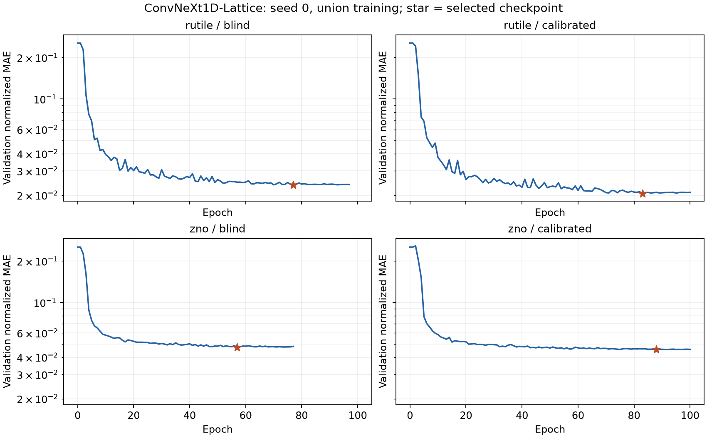

# ConvNeXt1D-Lattice：首轮 pilot 结果

2026-11-24。固定一套训练配方，分别训练 rutile / ZnO × blind / calibrated 四个模型。全部使用已发布的 `v0.2-pilot` 联合训练集，seed=0；测试预测导出后，由原统一 evaluator 评分。没有用测试集选择架构、超参数或 checkpoint。

这是 1D ConvNeXt 架构在晶格回归任务上的迁移实现，不是 AlphaDiffract 原论文完整任务的成绩复现。模型、引用、许可证与命令见 [基线文档](../../docs/ConvNeXt基线.md)。没有运行 cVAE 或其他学习基线，因此不能据此比较方法排名。

## 主成绩

平均相对误差 MRE = `mean(|prediction − truth| / |truth|) × 100%`，对 `(a,c)` 及该域 ID 条件平均，越低越好。联合域给旧、新 ID 条件各 50% 权重；五个 OOD/stress 条件不进入主平均。每个模型都只在联合训练集训练一次，以下三列是同一 checkpoint 的三个评测域。

| 原型 / 赛道 | v0.1 MRE % | v0.2 MRE % | 联合 MRE %（95% CI） | prior mean MRE % | 联合误差相对下降 |
| --- | ---: | ---: | ---: | ---: | ---: |
| rutile / blind | 0.0987 | 0.3827 | 0.2407 [0.2291, 0.2522] | 2.5309 | 90.49% |
| rutile / calibrated | 0.0789 | 0.3289 | 0.2039 [0.1920, 0.2161] | 2.5309 | 91.94% |
| zno / blind | 0.0858 | 0.9160 | 0.5009 [0.4735, 0.5277] | 2.5646 | 80.47% |
| zno / calibrated | 0.0646 | 0.8950 | 0.4798 [0.4523, 0.5060] | 2.5646 | 81.29% |

prior mean 不读取谱，是任务参考对照；它不是已训练的强基线。95% CI 按 512 个独立 test 结构进行 2000 次 cluster bootstrap，只反映测试结构采样，不包含训练种子方差。各域完整 CI、参数 Å 误差和 0.1% 成功率见 [matrix.csv](matrix.csv)。成对 normalized MAE 差值与 CI 见 [paired_vs_prior.json](paired_vs_prior.json)。

0.5% 成功率要求一条谱对应的 **a、c 同时**满足相对误差 ≤ 0.5%。

| 原型 / 赛道 | v0.1 成功率 % | v0.2 成功率 % | 联合成功率 % |
| --- | ---: | ---: | ---: |
| rutile / blind | 98.31 | 75.65 | 86.98 |
| rutile / calibrated | 98.67 | 78.12 | 88.40 |
| zno / blind | 98.76 | 54.72 | 76.74 |
| zno / calibrated | 99.41 | 56.74 | 78.08 |

## 此轮发现

四个模型在 v0.2 上的 MRE 是 v0.1 的 3.9–13.9 倍；v0.1 的 0.5% 成功率均超过 98%。对当前回归实现，新增条件确实拉开了难度。

最值得继续研究的是 **ZnO 的 hard_mixed**：三个曝光档、两条赛道的 MRE 均约 1.66%–1.70%，0.5% 成功率只有约 13%–16%；增加到 E=1000 仍没有明显改善。相应 hard_paired 的 MRE 约 0.09%–0.18%，成功率约 94%–98%。这种差异提示观测约束本身值得研究，不能只归因于低计数噪声；但仍需物理参考后验与收敛审计，才能区分信息不足和当前学习器的局限。

后续 cVAE + Physics 优先在 ZnO hard_mixed 的 blind / calibrated 两赛道上评测后验质量，再用 hard_paired 作信息增加的对照；rutile hard_mixed 提供较温和的困难层级。主要看 energy score、覆盖率和宽度，以及部署点误差。此处不预设生成式模型一定会胜出。

OOD 中，随机丢峰 drop30_ood 的 MRE 约 0.98%–1.23%，明显高于旧 ID；部分校准模型的峰展宽外推也有退化。无信号及极窄窗口 stress 不应混入 ID 平均，完整表保留了这些失败情形。

## 分条件成绩

以下均为 MRE %，每个条件含相同的 512 个测试结构。条件名称和窗口见 [v0.2 协议](../../docs/v0.2实验协议.md)。

### 新增困难 ID

| 条件 | rutile blind | rutile calibrated | ZnO blind | ZnO calibrated |
| --- | ---: | ---: | ---: | ---: |
| hard_mixed_e100 | 0.8184 | 0.7596 | 1.6785 | 1.7005 |
| hard_mixed_e1000 | 0.4840 | 0.4427 | 1.6609 | 1.6796 |
| hard_mixed_e300 | 0.5529 | 0.4965 | 1.6629 | 1.6825 |
| hard_paired_e100 | 0.1657 | 0.1154 | 0.1760 | 0.1225 |
| hard_paired_e1000 | 0.1349 | 0.0747 | 0.1591 | 0.0940 |
| hard_paired_e300 | 0.1405 | 0.0843 | 0.1584 | 0.0912 |

### OOD / stress（排除于主平均）

| 条件 | rutile blind | rutile calibrated | ZnO blind | ZnO calibrated |
| --- | ---: | ---: | ---: | ---: |
| broad_ood | 0.1213 | 0.1306 | 0.0907 | 0.1689 |
| drop30_ood | 1.0861 | 1.0323 | 1.2324 | 0.9799 |
| no_signal_stress | 2.6288 | 2.7473 | 2.6787 | 2.6284 |
| voigt_ood | 0.0710 | 0.0630 | 0.0595 | 0.0538 |
| window26_30_stress | 1.6698 | 1.7324 | 2.6787 | 2.5760 |

全部 17 个条件及 prior 对照见 [conditions.csv](conditions.csv)。纯无信号条件应结合 prior 对照解读，不能期待模型恢复观测中不存在的信息。

## 训练、选择规则与成本

每个模型使用 5000 个独立训练结构 / 10000 条固定谱；validation 为 512 个独立结构 / 6144 条谱。test 含 512 个独立结构 / 8704 条谱，其中主 ID 为 6144 条。未增加模拟、谱增强或外部预训练；没有物理后处理。

3,085,282 参数，FP32，batch=128，AdamW，学习率 5e-4，3 epoch warmup + cosine；先验归一化参数上的 SmoothL1（beta=0.02）。最多 100 epoch，按 validation normalized MAE 最低值选 checkpoint。具体停止原因和每个 epoch 的曲线均保留。

| 原型 / 赛道 | 实际 / 最佳 epoch | 最佳 val normalized MAE | 训练秒数 | 测试推理 ms/谱 | 测试完整流水线秒数 |
| --- | ---: | ---: | ---: | ---: | ---: |
| rutile / blind | 97 / 77 | 0.02377 | 302.8 | 0.0950 | 1.67 |
| rutile / calibrated | 100 / 83 | 0.02058 | 320.3 | 0.1012 | 1.98 |
| zno / blind | 77 / 57 | 0.04722 | 242.0 | 0.1024 | 1.76 |
| zno / calibrated | 100 / 88 | 0.04554 | 316.8 | 0.1037 | 1.64 |

四个正式拟合累计训练时间 1182.0 秒（0.328 accelerator-hours）；每次拟合使用一张 Ascend910B2，两个赛道各在一张卡上顺序运行两个原型，最多同时使用两张卡。硬件实际返回 Ascend910B2C，torch 2.7.1 + torch_npu 2.7.1.post8。该训练时间包含数据加载和 validation，不包含排队、容器启动、test 推理及 CPU 评分，也不是平台账单占用时间。先前 8-step NPU smoke 和 2-epoch 调试单独用于兼容性验证，不计入主结果或正式训练成本。

推理耗时是 batch=128 时、同步设备后的均摊吞吐时间，包含 adapter 的输入变换与设备传输，不是单条请求延迟；完整流水线另包括文件读取、哈希和预测写入。加载模型与 warmup 单独保存在结果 JSON。

完整训练历史、checkpoint SHA-256、冻结源码指纹、环境版本以及 validation/test 聚合评分位于 [training/](training/)。达到预算上限或触发 patience 都不等于证明充分收敛；不能把首轮模型视为该架构的性能上限。

## 数据与复现记录

- 数据：[smgjch/PXRD-LatticeBench](https://huggingface.co/datasets/smgjch/PXRD-LatticeBench)，固定 Hub commit `a7f5ce0c62d7fc5f50f1c2ce2d34b23f2e58a3d2`。四个联合 dataset_id 见 [results.json](results.json)。
- 每个 checkpoint 由训练与 validation 选择，选择完成后统一导出 test。训练 loader 仅允许 train/val；test 标签只在 CPU scorer 中打开。
- [verification.json](verification.json) 记录自动测试、CPU 接入验证、NPU 调试与正式提交检查；原 benchmark 创建时的验证记录保留历史含义。
- 公开仓库保存源码、聚合结果和训练历史；权重、逐谱预测与原始数据不纳入 Git。权重尚未作为公开资产发布，复现命令从冻结数据重新训练。

## 可以与不可以推断的结论

本轮只能衡量这个回归实现对冻结 synthetic pilot 的表现。v0.2 / v0.1 误差和每个 hard condition 可用于定位后续强基线及 cVAE + Physics 的评测重点；不能仅凭 CNN 点误差宣布后验多峰、cVAE 优于回归或真实实验泛化。后续后验方法应同时报告 energy score、覆盖率与区间宽度，而不能只用 oracle@K 代替部署点预测。多种子、同预算方法比较和真实实验验证仍待完成。
