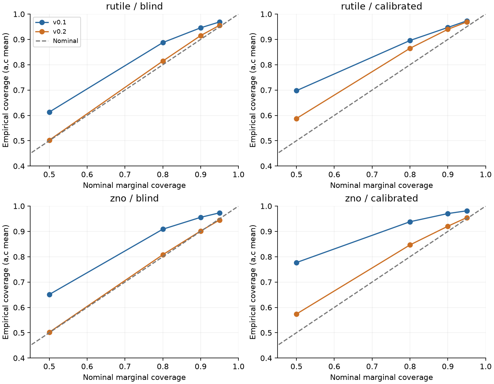
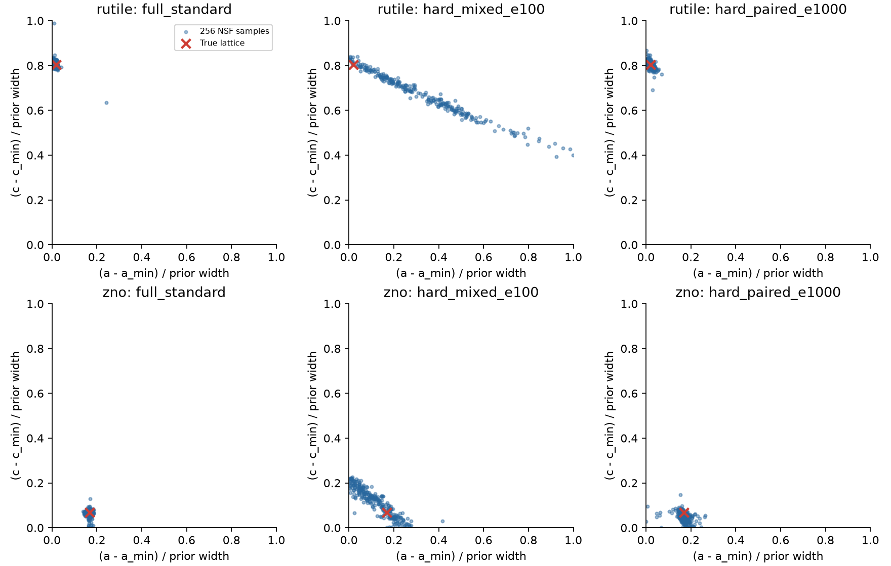
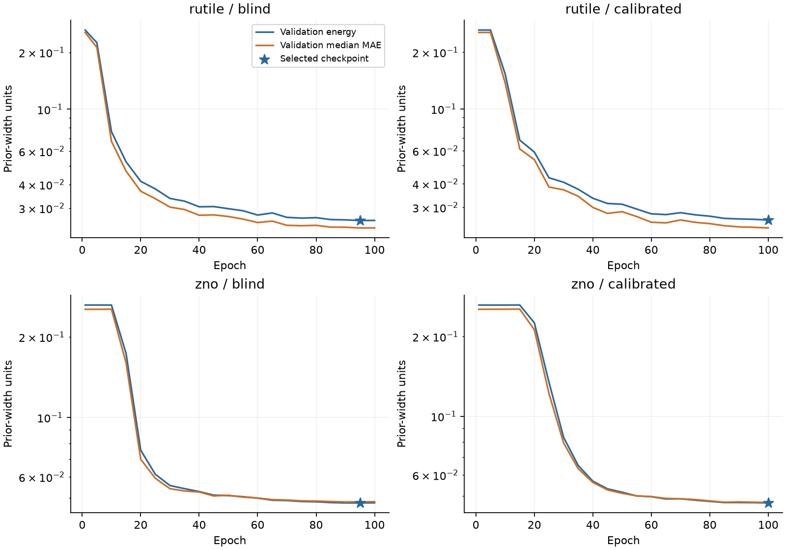

# Conditional NSF / NPE：首轮 pilot 结果

本轮完成 rutile / ZnO × blind / calibrated 四个独立拟合，均在冻结的 `v0.1+v0.2` pilot 训练集上从零训练，training seed=0。checkpoint 只按 validation energy score 选择；之后每张 test 谱输出 256 个原始后验样本，并由统一 evaluator 评分。没有增加模拟数据、测试集调参或物理后处理。

**结果：NSF 已学到有信息量的条件后验，联合 energy score 比无谱先验降低 81–90%；点精度与 ConvNeXt 接近，但没有全面胜出。** rutile blind 的点误差较低，ZnO blind 的配对差异区间包含零；两个 calibrated 任务的点误差更高。ID 后验区间整体偏保守，而无信号 OOD 上明显未能恢复正确先验。

这是 [Neural Spline Flows](https://arxiv.org/abs/1906.04032) 的任务迁移实现：有界 rational-quadratic coupling flow，使用与现有 ConvNeXt 点回归相同的谱编码器。模型、密度定义和复现命令见 [实现说明](../../docs/NSF基线.md)。本轮不是 sbi 软件性能测试，也不是某篇 XRD 论文原始成绩的复现。

每个拟合使用 5,000 个训练结构 / 10,000 张谱，512 个 validation 结构 / 6,144 张谱；测试每个任务含 512 个独立结构 / 8,704 张谱。主表只含 12 个 ID 条件，两个测试域各占 50%；另外五个 OOD/stress 条件单列。

## 点预测：后验样本边缘中位数

平均相对误差先对 a、c 和观测取平均，再乘 100；越低越好。ConvNeXt 比较复用 [已冻结的点预测](../convnext_pilot/README.md)，没有重新训练。

| 原型 / 赛道 | NSF v0.1 MRE % | NSF v0.2 MRE % | NSF 联合 MRE % | ConvNeXt 联合 MRE % | NSF 联合 0.5% 成功率 % |
| --- | ---: | ---: | ---: | ---: | ---: |
| rutile / blind | 0.0866 | 0.3769 | 0.2318 | 0.2407 | 87.11 |
| rutile / calibrated | 0.0937 | 0.3770 | 0.2353 | 0.2039 | 85.63 |
| zno / blind | 0.0834 | 0.9301 | 0.5068 | 0.5009 | 75.39 |
| zno / calibrated | 0.0850 | 0.9152 | 0.5001 | 0.4798 | 75.70 |

## 后验质量与校准

Energy score 在先验宽度归一化坐标下计算，越低越好；它同时惩罚偏差与不必要的分散。PriorSampler 忽略输入谱，提供无信息参考。

| 原型 / 赛道 | NSF energy v0.1 | NSF energy v0.2 | NSF energy 联合 | Prior energy 联合 | 相对 prior 降幅 % |
| --- | ---: | ---: | ---: | ---: | ---: |
| rutile / blind | 0.01030 | 0.04043 | 0.02537 | 0.26245 | 90.34 |
| rutile / calibrated | 0.01155 | 0.04017 | 0.02586 | 0.26245 | 90.15 |
| zno / blind | 0.00985 | 0.08983 | 0.04984 | 0.26673 | 81.31 |
| zno / calibrated | 0.01039 | 0.08823 | 0.04931 | 0.26673 | 81.51 |

90% coverage 是两个参数**边缘区间**覆盖率的平均，不是二维联合 90% credible region；width 是区间宽度占相应先验范围的比例。覆盖率必须和宽度一起阅读。

| 原型 / 赛道 | v0.1 coverage / width | v0.2 coverage / width | 联合 coverage / width |
| --- | ---: | ---: | ---: |
| rutile / blind | 94.58% / 4.23% | 91.50% / 15.01% | 93.04% / 9.62% |
| rutile / calibrated | 94.71% / 5.21% | 93.98% / 16.43% | 94.34% / 10.82% |
| zno / blind | 95.56% / 4.56% | 90.17% / 33.75% | 92.86% / 19.15% |
| zno / calibrated | 97.04% / 5.17% | 92.04% / 33.89% | 94.54% / 19.53% |

完整结果保留 a、c 各自的覆盖率、宽度、50/80/90/95% 等级、SBC rank histograms 和 oracle@K；oracle 使用真值挑候选，仅为诊断，不能替代实际点预测。

## 困难窗口与无信号诊断

mixed / paired 分别对三个曝光等级等权平均。下面都使用相同冻结 checkpoint；表中的覆盖率和宽度仍为 90% 边缘区间。

| 原型 / 赛道 | 条件 | MRE % | Energy ↓ | Coverage % | Width / prior % |
| --- | --- | ---: | ---: | ---: | ---: |
| rutile / blind | hard_mixed | 0.6164 | 0.06549 | 90.04 | 24.16 |
| rutile / blind | hard_paired | 0.1374 | 0.01537 | 92.97 | 5.85 |
| rutile / blind | no_signal_stress | 2.7669 | 0.29564 | 75.98 | 77.30 |
| rutile / calibrated | hard_mixed | 0.6529 | 0.06888 | 93.10 | 27.52 |
| rutile / calibrated | hard_paired | 0.1010 | 0.01146 | 94.86 | 5.33 |
| rutile / calibrated | no_signal_stress | 3.1267 | 0.43201 | 26.76 | 27.51 |
| zno / blind | hard_mixed | 1.6706 | 0.15889 | 88.25 | 58.99 |
| zno / blind | hard_paired | 0.1896 | 0.02078 | 92.09 | 8.50 |
| zno / blind | no_signal_stress | 2.5709 | 0.29021 | 76.27 | 78.09 |
| zno / calibrated | hard_mixed | 1.6659 | 0.15799 | 88.18 | 58.93 |
| zno / calibrated | hard_paired | 0.1645 | 0.01847 | 95.90 | 8.85 |
| zno / calibrated | no_signal_stress | 2.6086 | 0.30147 | 59.96 | 61.79 |

无信号条件的正确后验是先验；模型没有为此加入解析 fallback。有限 256 样本的 prior 中央区间在总体上的期望覆盖率约为 89.3%，期望宽度约为先验的 89.3%，不是恰好 90%。OOD/stress 的 rank histogram 只作诊断，不能当成 ID 校准证据。

ZnO 的 mixed 窗口仍然有区分度：两条赛道的 MRE 约 1.67%，90% 区间宽度约占先验 59%；paired 窗口的 MRE 为 0.16–0.19%，区间宽度约为先验的 8.5–8.9%。这支持同时检查点误差和不确定性的实验设计，但不能仅凭模型样本宣称存在多个真实后验模式。无信号下平均覆盖率只有 26.8–76.3%，明确表明当前 NPE 的 ID 校准不能自动推广到 OOD；也不能由此直接推断尚未评测的 cVAE + Physics 会更好。

下面展示每个原型按 group ID 字典序选出的第一个测试结构，使用 calibrated 赛道；同一行三个条件共享真值，选择不依据误差或覆盖率。图中为模型样本，尚无认证物理后验作为形状参考。选择规则及观测 ID 见 [posterior_examples.json](posterior_examples.json)。

## 配对比较与不确定性

在相同测试结构上做 2,000 次结构 bootstrap。下表是联合域 NSF − ConvNeXt 的 normalized MAE 差值，正值表示 NSF 点误差更高；区间只描述当前已训练模型的测试结构不确定性，不包含训练种子方差。

| 原型 / 赛道 | Δ normalized MAE | 95% CI |
| --- | ---: | --- |
| rutile / blind | -0.000905 | [-0.001555, -0.000244] |
| rutile / calibrated | +0.003155 | [+0.002316, +0.004037] |
| zno / blind | +0.000563 | [-0.000256, +0.001550] |
| zno / calibrated | +0.002039 | [+0.001079, +0.003109] |

[paired_comparisons.json](paired_comparisons.json) 还包含两个单独测试域及 NSF 对 PriorSampler 的 energy、对 PriorMean 的点误差比较。

## 训练成本与复现

模型含 3,303,286 个可训练参数；ConvNeXt 点回归含 3,085,282 个。两者共享编码器设计和冻结数据预算，但输出头、目标函数、学习率、weight decay、验证频率和 checkpoint 选择指标不同，不能称为完全相同优化配方或相同计算量。

| 原型 / 赛道 | 完成 / 选中 epoch | 选中 val energy | 训练秒 | 256 样本推理 ms/谱 | test 流水线秒 |
| --- | ---: | ---: | ---: | ---: | ---: |
| rutile / blind | 100 / 95 | 0.02577 | 420.7 | 0.181 | 3.82 |
| rutile / calibrated | 100 / 100 | 0.02567 | 409.1 | 0.168 | 3.58 |
| zno / blind | 100 / 95 | 0.04793 | 418.4 | 0.187 | 3.89 |
| zno / calibrated | 100 / 100 | 0.04700 | 410.3 | 0.169 | 3.62 |

四个正式拟合累计训练 1658.5 秒（0.461 accelerator-hours），最多并发两张 Ascend910B2；设备返回 Ascend910B2C。训练时间包含数据加载和 validation，不含平台排队、容器启动、预测导出、CPU 评分；8-step smoke 和 2-epoch 调试另行记录。推理时间是 batch=128 的同步吞吐均摊时间，包含输入变换与传输，每谱生成 256 样本，不是单请求延迟或与单个回归点等量的操作。

- 数据：[PXRD-LatticeBench](https://huggingface.co/datasets/smgjch/PXRD-LatticeBench)，固定 Hub commit `a7f5ce0c62d7fc5f50f1c2ce2d34b23f2e58a3d2`。没有重新生成或修改 benchmark。
- [matrix.csv](matrix.csv)、[conditions.csv](conditions.csv)、[results.json](results.json)：完整三域成绩、17 个条件、数据与提交指纹。
- [training/](training/)：训练历史、选中 checkpoint 哈希、源码指纹、版本、validation/test 聚合指标。训练选优与重新导出 validation 使用不同固定 Monte Carlo 样本，energy 不要求逐位相同。
- [verification.json](verification.json)：36 项自动测试、NPU 实测、权重与源码哈希审计、评分范围。权重和逐谱预测保留在实验存储，尚未作为公开下载资产发布。

数值审计：全部 test（含 OOD/stress）共 8,912,896 个后验样本，其中两个因 FP32 舍入微量超出数学先验边界，最大偏移为先验宽度的 `3.58e-7`。没有裁剪或删除这些样本，evaluator 的越界指标保留原值；详细计数见 verification。重新导出 validation 与训练选优的 energy 差值为 `1.9e-5` 至 `1.4e-4`，来自两套独立固定 Monte Carlo 样本。

## 本轮结论的范围

这是单 seed、synthetic pilot 的方法接入与首轮性能测量。结果不能证明 NSF 达到能力上限，也不能替代多种子、更大训练集、收敛认证的物理参考或真实实验验证。尚未训练或比较 cVAE + Physics。后续超参和方法改进应继续只使用 train/validation，并单独登记预算。
